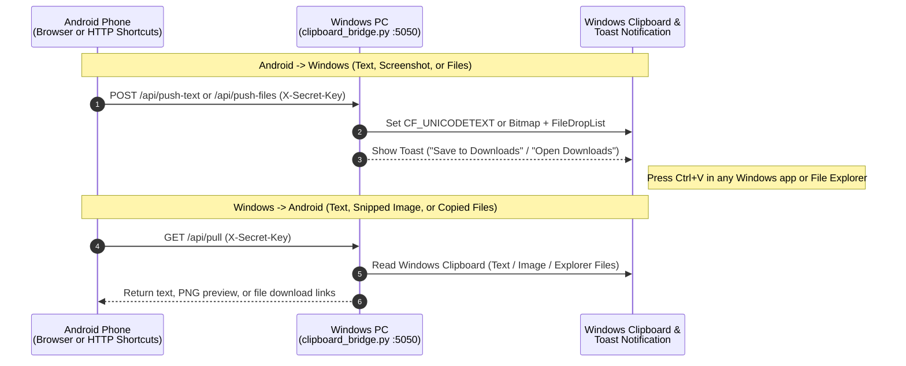
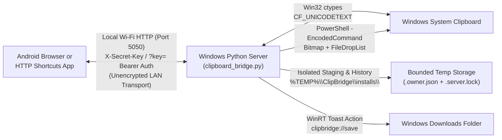

# ClipBridge

**Your clipboard, connected.**

Move text, screenshots, and files between **Windows** and **Android** over your local Wi-Fi network—with **no custom ClipBridge Android APK** and **zero Python `pip` dependencies** on Windows.

[](https://github.com/zeyadAhmed01/ClipBridge/actions/workflows/ci.yml)
[](https://www.python.org/)
[](#requirements--compatibility)
[](#requirements--compatibility)
[](./LICENSE)

[Quick Start — Windows](#quick-start--windows) · [Android Setup](#android-setup) · [Features](#features) · [How It Works](#how-it-works) · [Security & Privacy](#security--privacy) · [Troubleshooting](#troubleshooting) · [Contributing](./CONTRIBUTING.md)

---

## Overview

**ClipBridge** runs a lightweight, standard-library Python HTTP server (`clipboard_bridge.py`) on your Windows PC and bridges your system clipboard and `Downloads` folder to your Android phone over a trusted private Wi-Fi network:

* **On Windows:** Requires **Python 3.10+** and uses native Win32 clipboard APIs (`ctypes`) plus short-lived PowerShell helpers for images, File Explorer `FileDropList` items, and Windows Toast notifications.
* **On Android (Browser Mode):** Needs **no app installation at all**—open the built-in mobile web dashboard in your Android browser to send and receive text, screenshots, and files.
* **On Android (Quick Settings & Share Menu):** Optionally pair with the free, open-source **[HTTP Shortcuts](https://http-shortcuts.rmy.ch/)** app using ClipBridge's 1-click **Import from URL** endpoint (`/setup/shortcuts.json`) to send content directly from Android's **Share sheet** or **Quick Settings tile**.

> **Repository & Release Status:** ClipBridge is a source-first project. Always install from the individual repository source files (`clipboard_bridge.py`, `manage.bat`, `http_shortcuts_android.json`), not from older archived ZIP snapshots. No formal GitHub Release has been published yet while final physical-device acceptance is completed (see [`docs/RELEASE_READINESS.md`](./docs/RELEASE_READINESS.md)).

---

## Product Demonstration

<!-- Real hardware screen recording / screenshot slot: add verified, redacted media here after physical Android + Windows 11 capture (see docs/RELEASE_READINESS.md). -->



**Typical daily workflows:**

1. **Phone → PC (`Ctrl+V`):** Share a screenshot or file from your phone (or paste text in the mobile dashboard). Within moments, press `Ctrl+V` on Windows to paste the image into a chat/design app, paste the file into File Explorer, or click **Save to Downloads** on the Windows Toast notification.
2. **PC → Phone:** Copy text, capture a screenshot (`Win+Shift+S`), or copy files (`Ctrl+C`) in Windows File Explorer, then tap **Pull from PC** on your phone to read the text, preview/save the image, or download the files.

*(A real 20–30 second Windows + Android capture is tracked as a pre-release deliverable in [`docs/RELEASE_READINESS.md`](./docs/RELEASE_READINESS.md); no synthetic mockups are used here.)*

---

## Why ClipBridge?

Moving a verification code, URL, screenshot, or PDF between an Android phone and a Windows PC often means messaging yourself in a chat app, emailing attachments to your own inbox, or signing into a cloud drive on both devices.

ClipBridge focuses on a practical local-network workflow:

* **No cloud account or external relay:** Data stays on your local Wi-Fi network between your phone and PC.
* **Native Windows `Ctrl+V` behavior:** Incoming screenshots populate **both** a Windows clipboard `Bitmap` and a `FileDropList`, so `Ctrl+V` works in image editors/chat apps *and* in Windows File Explorer.
* **Staged transfers with bounded disk usage:** Uploaded files stream to an installation-scoped temporary directory rather than cluttering `Downloads` automatically; you choose when to click **Save to Downloads**.
* **No custom Android background service:** Use a browser bookmark when you want zero Android installs, or HTTP Shortcuts when you want native Android Share-menu and Quick Settings actions.

---

## Features

### Implemented & Verified (Automated Suite + Windows 11 Host APIs)

* **Bidirectional UTF-8 Text Transfer:** Reads and writes `CF_UNICODETEXT` directly via Win32 `user32.dll` / `kernel32.dll` (`ctypes`) with support for Unicode, emoji, and multiline text (up to 2 MB).
* **Dual-Format Screenshot Paste (Android → Windows):** Single-image uploads set both `Bitmap` and `FileDropList` (`CF_HDROP`) on the Windows clipboard so you can paste pixels into apps or paste a file into File Explorer.
* **Single & Multi-File Streaming:** Streams multipart and raw uploads in 64 KB chunks (`stream_multipart_to_staged_dir`) into isolated per-transfer staging directories without buffering whole files in RAM.
* **Windows Clipboard Paste & PC → Android Pull:** Pulls copied Windows text, clipboard bitmaps (converted to PNG), or files copied in Windows File Explorer (`Ctrl+C`) to your phone.
* **Windows Toast Notifications & Protocol Actions:** Native WinRT Toast notifications provide **Save to Downloads** (`clipbridge://save`) and **Open Downloads** (`clipbridge://open`) buttons.
* **Android Browser Web Dashboard:** Built-in responsive dark-mode web UI (`http://<pc-ip>:5050/?key=<secret_key>`) with text/file push, PC clipboard pull, session transfer history, and live storage usage.
* **1-Click HTTP Shortcuts Integration:** Serves `/setup/shortcuts.json?key=<secret_key>` with your PC's local IPv4 address and access key pre-populated for Android Quick Settings and Share-menu workflows.
* **Bounded Temporary Storage & Active-Clipboard Protection:** Enforces configurable retention (`max_storage_mb`: `1024 MB`, `retention_minutes`: `60 min`, `max_history_items`: `25`) while protecting files currently on the Windows clipboard (`GetClipboardSequenceNumber()`) or being downloaded via active leases.
* **Concurrent Upload Isolation:** Simultaneous uploads write to private `.staging_<token>` folders and commit atomically (`tx_<session>_<seq>_<token>`), preventing race conditions or partial-upload corruption.
* **Safe, Non-Destructive Cleanup:** Web UI **Clean Temp**, `POST /api/cleanup`, and CLI `python clipboard_bridge.py --cleanup` reclaim expired/inactive files while preserving active clipboard data. Offline CLI cleanup acquires and holds an exclusive `.server.lock` across verification and cleanup, failing closed if server state or ownership cannot be verified.
* **Installation-Scoped Isolation & Ownership Validation:** Each installation derives a deterministic `<install_id>` from its canonical script path, isolating temporary files under `%TEMP%\ClipBridge\installs\<install_id>` (`.owner.json` + `.server.lock`), scoping Windows Startup (`ClipBridge_<install_id>.vbs`) and Firewall rules (`ClipBridge_<port>_<install_id>`), running a non-destructive preflight (`--preflight-install`) before setup, and verifying ownership before uninstalling.

### Pending Physical-Device & Cutover Acceptance

To keep release status transparent, the following items are implemented in code and covered by unit/API tests, and are awaiting final interactive hardware verification prior to publishing `v1.0.0` (tracked in [`docs/RELEASE_READINESS.md`](./docs/RELEASE_READINESS.md)):

* End-to-end physical Android handset testing over Wi-Fi (browser mode + HTTP Shortcuts Share sheet and Quick Settings tile).
* Interactive Windows Explorer/image-app `Ctrl+V` and live Toast button clicks after cutting over from the host's legacy `D:\ClipboardBridge` installation on port `5050`.
* Separate physical desktop validation on Windows 10.

---

## How It Works



1. **Authentication:** Every request except `GET /ping` requires your installation's `secret_key` via the `X-Secret-Key` HTTP header or `?key=` URL query parameter, validated with constant-time `secrets.compare_digest`. Transport uses plain HTTP over your local network (no TLS).
2. **Text Path:** Handled directly in Python using Win32 `OpenClipboard`, `GetClipboardData`, and `SetClipboardData` (`CF_UNICODETEXT`).
3. **File & Image Path:** Uploaded files stream in 64 KB chunks into `%TEMP%\ClipBridge\installs\<install_id>\staged\.staging_<token>`, then atomically commit to `tx_<session>_<seq>_<token>`. Short-lived, timeout-bounded `powershell.exe -NoProfile -NonInteractive -STA -EncodedCommand` calls place the staged paths (and bitmap data for single images) onto the Windows clipboard.
4. **Downloads & Retention:** Staged files are copied to your Windows `Downloads` folder only when you trigger **Save to Downloads** (Toast button or `/api/save-latest`). A background maintenance loop and startup orphan recovery keep disk usage within `max_storage_mb` and `retention_minutes`.

See [`docs/ARCHITECTURE.md`](./docs/ARCHITECTURE.md) for the full endpoint table and storage lifecycle details.

---

## Quick Start — Windows

### Prerequisite

* **Windows 11** (or Windows 10) with **Python 3.10 or newer** installed and added to `PATH` (`python --version`). No `pip install` step is needed.

> **Upgrading from an older ClipBridge / `ClipboardBridge` installation?**
> Do **not** install over an active legacy instance listening on port `5050`. `manage.bat` option `[1]` runs a non-destructive preflight (`--preflight-install`) and will safely abort if port `5050`, `HKCU\Software\Classes\clipbridge`, or `ClipboardBridge_SilentStartup.vbs` is owned by another installation. Follow the [Legacy Installation Migration steps in `docs/TROUBLESHOOTING.md`](./docs/TROUBLESHOOTING.md#8-migrating-from-an-older-clipbridge-installation) first.

### Step 1: Clone or Download the Repository

Place the repository in a permanent folder on your PC (for example, `D:\ClipBridge\`):

```powershell
git clone https://github.com/zeyadAhmed01/ClipBridge.git
cd ClipBridge
```

### Step 2: Run `manage.bat` as a Normal User and Select `[1]`

Double-click `manage.bat` (or run `.\manage.bat` in a **normal, non-administrator** terminal) and select **`[1] Install & Start Silently`**:

1. **Safety check & preflight:** Refuses to run if the window is elevated (Administrator), stops any running process belonging to *this* installation path, and runs `python clipboard_bridge.py --preflight-install` to confirm port `5050`, `clipbridge://`, and Windows Startup have no foreign conflicts.
2. **Configuration & protocol registration:** Creates `config.json` (if not already present) with a random `secret_key` and registers `HKCU\Software\Classes\clipbridge` for this installation (`--register-only`).
3. **Firewall check:** Checks whether the installation-scoped rule `ClipBridge_<port>_<install_id>` exists.
4. **Silent background startup:** Creates `%APPDATA%\Microsoft\Windows\Start Menu\Programs\Startup\ClipBridge_<install_id>.vbs` (`--install-startup`), launches the background server via `pythonw.exe` without a console window, and verifies that it is listening (`RUNNING:<pid>`).

### Step 3: Inspect Connection Info (Read-Only Option `[2]`)

Select **`[2] Show Connection Info, Secret Key & Android Import URL (Read-Only)`** (or run `python clipboard_bridge.py --status`):

* Displays your `Install ID`, `Config File`, `Temp Storage Dir`, `Protocol Handler` ownership status, **Web Dashboard URL**, **1-Click Android Import from URL**, and whether the background server is `ONLINE (RUNNING:<pid>)` or `STOPPED`.
* **Strictly read-only:** Option `[2]` never writes to the Windows Registry, Startup folder, Firewall, or temporary storage. If `config.json` has not been created yet, it reports `[Not configured yet — run manage.bat option [1] to generate config.json]` instead of printing an unsaved random key.

### Step 4: Configure Windows Firewall (Administrator Option `[7]`)

Windows separates normal-user server execution from Administrator firewall rule management:

1. If your Android phone cannot connect over your home Wi-Fi, confirm your Windows Wi-Fi network profile is set to **Private** (only on a network you trust).
2. Right-click `manage.bat` → **Run as administrator**, then select **`[7] Configure Private LAN Firewall Only`**.
3. Option `[7]` verifies rule ownership (`--check-firewall`) and creates inbound TCP rule `ClipBridge_<port>_<install_id>` restricted to **`profile=private`** and **`remoteip=localsubnet`**.
4. **Close the Administrator window immediately afterward.** Never launch or restart the server (`[1]` or `[3]`) from an elevated window.

### Step 5: Verify, Restart, Stop, Clean Up, or Uninstall

All lifecycle actions are available from `manage.bat` (or directly via `python clipboard_bridge.py` CLI flags):

| `manage.bat` Option | CLI Equivalent | Behavior |
| :--- | :--- | :--- |
| **`[2]` Status (Read-Only)** | `python clipboard_bridge.py --status` | Prints connection URLs, protocol ownership, and server status with zero side effects. Also check `http://127.0.0.1:5050/ping`. |
| **`[3]` Restart Server** | *(Normal user only)* | Stops only this installation's Python server process and relaunches it non-elevated. |
| **`[4]` Stop Server** | *(Process-scoped PowerShell)* | Terminates only the Python process whose command line matches this installation's `clipboard_bridge.py`; never kills unrelated apps on port `5050`. |
| **`[6]` Clean Temp Storage** | `python clipboard_bridge.py --cleanup` | Reclaims expired/inactive staged and history files while preserving active Windows clipboard files. Offline cleanup holds `.server.lock` and fails closed on ambiguity. |
| **`[5]` Remove Integration** | `--uninstall-startup`, `--uninstall-firewall`, `--unregister` | Stops this installation's server and removes only startup launchers, firewall rules, and `clipbridge://` registrations owned by this installation. Preserves `config.json`, `Downloads`, and other installations. |

---

## Android Setup

Ensure your Android phone and Windows PC are connected to the **same trusted Private Wi-Fi network**.

### Method 1: Browser-Only Mode (Zero Android App Installs)

1. Run `manage.bat` option **`[2]`** on Windows and copy the **Web Dashboard & History UI** URL:
   `http://<your-pc-ip>:5050/?key=<your-secret-key>`
2. Open that URL in Chrome (or your preferred Android browser) and bookmark it or select **Add to Home screen**.
3. From the dashboard you can:
   * **Send Text to PC:** Paste or type text and tap **Push Text to PC**, then press `Ctrl+V` on Windows.
   * **Send Screenshots or Files to PC:** Tap **Upload Files / Images**, select one or more items, and send them straight to the Windows clipboard and Toast notification.
   * **Pull from PC:** Tap **Pull PC Clipboard** to view text copied on Windows, preview/save a Windows clipboard image, or download files copied in Windows File Explorer.

### Method 2: HTTP Shortcuts App (Quick Settings Tile & Android Share Menu)

For 1-tap access from any Android app without opening a browser tab first:

1. Install the free, open-source **[HTTP Shortcuts](https://play.google.com/store/apps/details?id=ch.rmy.android.http_shortcuts)** app ([website](https://http-shortcuts.rmy.ch/) / [F-Droid](https://f-droid.org/packages/ch.rmy.android.http_shortcuts/)).
2. In `manage.bat` option **`[2]`**, copy the **1-Click Android 'Import from URL'** address:
   `http://<your-pc-ip>:5050/setup/shortcuts.json?key=<your-secret-key>`
3. In **HTTP Shortcuts**, tap **Settings (gear icon)** → **Import / Export** → **Import from URL**, paste the URL, and confirm.
4. This imports three ready-to-use shortcuts pre-configured with your PC's IP and `secret_key`:
   * **Send Text to PC** (`POST /api/push-text`)
   * **Send File or Screenshot to PC** (`POST /api/push-files`)
   * **Get from PC** (`GET /api/pull`)
5. **Enable the Quick Settings Tile:** Pull down your Android notification shade, tap the **Edit (pencil)** icon, and drag the **HTTP Shortcuts** tile into your active Quick Settings tiles.
6. **Use the Android Share Menu:** Select any screenshot, photo, or file(s) in your Android Gallery or file manager, tap **Share** → **HTTP Shortcuts**, and choose **Send File or Screenshot to PC**.

### Important Note on Android Browser Clipboard Restrictions (Plain HTTP)

Modern Android browsers restrict programmatic clipboard writes (`navigator.clipboard.write()`, especially for images) on unencrypted `http://` origins:

* **Text:** The web dashboard provides direct copy/paste controls and fallback selection.
* **Images pulled from Windows (`PC → Phone`):** When pulling a Windows screenshot in your Android browser, **long-press the displayed image preview** and choose **Copy image** or **Save image**. Do **not** disable Chrome's `unsafely-treat-insecure-origin-as-secure` security flags for general browsing.

---

## Requirements & Compatibility

| Component | Requirement | Verification & Compatibility Status |
| :--- | :--- | :--- |
| **Windows OS** | Windows 11 (or Windows 10) | **Windows 11** verified against live Win32 clipboard, PowerShell `DataObject` (`Bitmap` + `CF_HDROP`), WinRT Toast XML, and `manage.bat` isolation checks, plus GitHub Actions `windows-latest`. **Windows 10** uses the same Win32/WinRT APIs but has not had separate physical desktop testing. |
| **Python** | Python 3.10+ (`python` & `pythonw` in `PATH`) | Standard library only (zero `pip` dependencies). Automated test suite (`36/36` tests) runs in CI on **Python 3.10 and 3.12** across `windows-latest` and `ubuntu-latest`. |
| **Android** | Android browser (Chrome, Firefox, Edge) | Optional [HTTP Shortcuts](https://http-shortcuts.rmy.ch/) app for Quick Settings tile and Share-menu integration. Physical handset LAN acceptance is tracked in [`docs/RELEASE_READINESS.md`](./docs/RELEASE_READINESS.md). |
| **Network** | Same trusted Private Wi-Fi LAN | Default TCP port `5050` (`configurable` in `config.json`). Windows Firewall rule (`ClipBridge_<port>_<install_id>`) restricts inbound access to `profile=private` and `remoteip=localsubnet`. |

---

## Security & Privacy

ClipBridge is built for **personal convenience on a trusted home or private LAN**. Review these operational boundaries before use:

* **No Cloud Account or Third-Party Servers:** Transfers occur directly between your Android device and Windows PC over local Wi-Fi.
* **Unencrypted HTTP Transport (No TLS):** All traffic—including clipboard contents, files, and the `secret_key`—travels over **plain HTTP**. Do **not** use ClipBridge on public, shared, hotel, campus, or guest Wi-Fi networks, and **never port-forward** port `5050` on your router.
* **Bearer Key Authentication & URL Hygiene:** All endpoints except `/ping` require your `secret_key` (`X-Secret-Key` header or `?key=` query parameter), checked via constant-time `secrets.compare_digest`. Because dashboard and import URLs include `?key=<secret_key>`, treat those URLs like passwords: do not share them in screenshots, logs, or issue reports, and regenerate `secret_key` in `config.json` (and re-import shortcuts) if exposed.
* **Not for High-Risk Secrets:** Because transport is plain HTTP and temporary files remain unencrypted on disk during the retention window, do not use ClipBridge to transfer passwords, private cryptographic keys, or sensitive regulated documents.
* **Installation-Scoped Storage &Bounded Retention:** Temporary files are isolated per installation under `%TEMP%\ClipBridge\installs\<install_id>` with an `.owner.json` manifest and `.server.lock` file lock. Retention is bounded by `max_storage_mb` (`1024 MB`), `retention_minutes` (`60 min`), and `max_history_items` (`25`). Startup orphan cleanup and `--cleanup` reclaim old transfers while protecting active clipboard files and failing closed if ownership cannot be verified.
* **Privilege Separation:** The ClipBridge server always runs as a **normal, non-elevated Windows user** (`manage.bat` options `[1]` and `[3]` block elevated execution). Administrator privileges are used **only** in option `[7]` to configure the Private/LocalSubnet Windows Firewall rule.

For full security details and private vulnerability reporting instructions, read [`SECURITY.md`](./SECURITY.md).

---

## Troubleshooting

Quick fixes for common setup questions (click any topic for step-by-step instructions in [`docs/TROUBLESHOOTING.md`](./docs/TROUBLESHOOTING.md)):

* **[Connection failure / `timeout socket closed`](./docs/TROUBLESHOOTING.md#1-connection-failure-or-timeout-socket-closed)** — Verify `http://localhost:5050/ping` on Windows and confirm both devices are on the same private Wi-Fi subnet without AP/client isolation.
* **[Windows Firewall configuration](./docs/TROUBLESHOOTING.md#2-windows-firewall-configuration-option-7)** — Ensure Wi-Fi is set to **Private** (on a trusted network) and run `manage.bat` option **`[7]`** as Administrator to create `ClipBridge_<port>_<install_id>`.
* **[Incorrect IP address or port](./docs/TROUBLESHOOTING.md#3-incorrect-wi-fi-ip-address-or-port)** — Use the IPv4 address under **Wireless LAN adapter Wi-Fi** (ignore WSL, Hyper-V, VPN, or VirtualBox virtual adapters).
* **[Existing port `5050` conflict](./docs/TROUBLESHOOTING.md#4-existing-port-5050-conflict)** — Identify what owns port `5050` (`OCCUPIED:<pid>`) or change `"port"` in `config.json`.
* **[Android browser clipboard permissions over HTTP](./docs/TROUBLESHOOTING.md#5-android-browser-clipboard-permissions-over-http)** — Use long-press **Copy image** / **Save image** for PC → Android images over plain HTTP.
* **[HTTP Shortcuts import failures](./docs/TROUBLESHOOTING.md#6-http-shortcuts-import-from-url-failures)** — Check the exact `/setup/shortcuts.json?key=<secret_key>` URL from `manage.bat` option `[2]` or import `Android_HTTP_Shortcuts_Import.json` manually.
* **[Windows Toast buttons (`Save to Downloads` / `Open Downloads`)](./docs/TROUBLESHOOTING.md#7-windows-toast-buttons-do-nothing)** — Verify `Protocol Handler : Registered (this installation)` in `manage.bat` option `[2]`.
* **[Migrating from an older ClipBridge installation](./docs/TROUBLESHOOTING.md#8-migrating-from-an-older-clipbridge-installation)** — Safely stop and clean up legacy `ClipboardBridge` startup/registry/firewall entries before installing the current version.

---

## Roadmap

* [x] Bounded temporary storage quota (`max_storage_mb`), TTL (`retention_minutes`), and active-clipboard protection
* [x] Concurrent upload isolation and installation-scoped resource ownership (`<install_id>`)
* [ ] Complete physical Android handset & interactive cutover acceptance for the `v1.0.0` release tag ([`docs/RELEASE_READINESS.md`](./docs/RELEASE_READINESS.md))
* [ ] Optional terminal QR code for instant mobile dashboard & shortcut pairing
* [ ] Optional local HTTPS / TLS mode for encrypted Wi-Fi transport
* [ ] Optional standalone Windows `.exe` packaging for systems without Python installed

---

## Contributing & License

* **Contributing:** Bug reports, compatibility test results, and pull requests are welcome! Please read [`CONTRIBUTING.md`](./CONTRIBUTING.md) and [`CODE_OF_CONDUCT.md`](./CODE_OF_CONDUCT.md) before opening a PR.
* **Security Vulnerabilities:** Do **not** file public issues for security bugs. Follow the private reporting process in [`SECURITY.md`](./SECURITY.md).
* **License:** Distributed under the [MIT License](./LICENSE) by **Zeyad Ahmed**.
