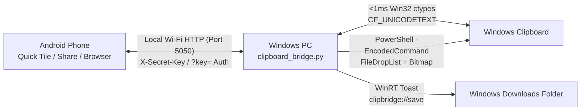

# ClipBridge

**Your clipboard, connected.**
An easy, lightweight way to move text, screenshots, and files between **Windows** and **Android** over local Wi-Fi—with **no custom Android app required**.

[](https://github.com/zeyadAhmed01/ClipBridge/actions/workflows/ci.yml)
[](https://www.python.org/)
[](#requirements-and-compatibility)
[](#requirements-and-compatibility)
[](./LICENSE)

[Quick Start](#quick-start) · [How It Works](#how-it-works) · [Security & Privacy](#security-and-privacy) · [Troubleshooting](./docs/TROUBLESHOOTING.md) · [Contributing](./CONTRIBUTING.md)

---

## Why ClipBridge?

Moving a link, verification code, screenshot, or PDF between your Android phone and Windows PC usually means emailing yourself, opening a chat app, or running heavy background sync suites.

ClipBridge takes a minimal approach:
* **Zero-dependency Windows server**: Runs on standard Python 3.8+ using Windows' built-in Win32 clipboard APIs (`ctypes`) and native PowerShell Toast notifications—no `pip install`, no Electron wrapper, and no background cloud account.
* **No custom Android APK**: Works directly from your Android browser (via the built-in mobile web dashboard) or from Android's **Quick Settings notification shade** and **Share menu** using the open-source [HTTP Shortcuts](https://http-shortcuts.rmy.ch/) app.
* **True `Ctrl+V` on Windows**: Incoming text, screenshots, and files are written straight to the Windows system clipboard (`CF_UNICODETEXT`, `Bitmap`, and `FileDropList`), so you can immediately press `Ctrl+V` in File Explorer, editors, browsers, or chat apps.

---

## Features

### Supported Today
* **Bidirectional Text Sync (`<1 ms` on Windows)**: Uses native Win32 `OpenClipboard` / `SetClipboardData` calls in Python with no subprocess overhead for text.
* **Dual-Format Screenshot Paste (Android → Windows)**: Sharing a screenshot from Android places **both** an image `Bitmap` and a `FileDropList` on the Windows clipboard—paste it as an image in chat/design apps or as a `.png` file in File Explorer.
* **Actionable Windows Toast Notifications**: Incoming screenshots and files pop up a native Windows 10/11 Toast notification with **Save to Downloads** and **Open Downloads** buttons (`clipbridge://`).
* **Chunked Multi-File Transfers**: Stream single or multiple files (PDFs, ZIPs, videos, APKs) in 64 KB chunks without loading entire files into RAM.
* **PC → Android Pull**: Fetch copied Windows text or snipped screenshots (`Win+Shift+S`) to your Android clipboard, or download copied Windows Explorer files (`Ctrl+C`) straight to your phone's `Downloads` folder.
* **1-Click "Import from URL" Onboarding**: ClipBridge serves `/setup/shortcuts.json` with your PC's local IP and generated secret key pre-filled.
* **Session Transfer History**: Built-in dark-mode web dashboard (`http://<pc-ip>:5050/?key=<secret_key>`) with recent text and file history.

---

## Quick Start

> **Important:** "No dedicated Android app" means you do not need to install a custom ClipBridge APK on your phone. On your **Windows PC**, you do need **Python 3.8+** installed and `clipboard_bridge.py` running.

### 1. Start ClipBridge on Windows

1. Clone or download this repository into a permanent folder (for example, `D:\ClipBridge\`):
   ```powershell
   git clone https://github.com/zeyadAhmed01/ClipBridge.git
   cd ClipBridge
   ```
2. Right-click `manage.bat` and choose **Run as administrator**.
3. Press **`1`** (**Install & Start Silently**). This will:
   * Auto-create `config.json` with a random `secret_key` and your Windows `Downloads` path.
   * Register the `clipbridge://` protocol for the Toast **Save to Downloads** button.
   * Allow port `5050` in Windows Firewall.
   * Add a silent startup launcher to your Windows Startup folder and start the server.
4. Note the **Web Dashboard URL** and **Import from URL** printed in the terminal.

### 2. Connect from Android (Choose Either Method)

* **Option A — Zero-Install Browser Mode**: Open Chrome on your Android phone and visit `http://<your-pc-ip>:5050/?key=<your-secret-key>` to send/pull text, screenshots, and files.
* **Option B — Quick Settings Tile & Share Menu (Recommended)**:
  1. Install the free, open-source **[HTTP Shortcuts](https://play.google.com/store/apps/details?id=ch.rmy.android.http_shortcuts)** app from Google Play.
  2. Open **HTTP Shortcuts** → **Settings (gear)** → **Import / Export** → **Import from URL**, and paste `http://<your-pc-ip>:5050/setup/shortcuts.json?key=<your-secret-key>`.
  3. Drag the **HTTP Shortcuts** tile into your Android Quick Settings shade.
  4. *(One-time Chrome flag for PC → Android image clipboard)*: Open Chrome on Android, go to `chrome://flags/#unsafely-treat-insecure-origin-as-secure`, add `http://<your-pc-ip>:5050`, set to **Enabled**, and tap **Relaunch**.

---

## How It Works



1. **Text transfers** are handled in-process via `user32.dll` and `kernel32.dll` (`ctypes`).
2. **Images and Explorer files** use short-lived, timeout-bounded `powershell.exe -EncodedCommand` calls with `.NET` `System.Windows.Forms.Clipboard`.
3. **Large uploads** are streamed in 64 KB chunks to `%TEMP%\ClipBridge\staged` and only copied to `Downloads` if you click **Save to Downloads** on the Windows Toast notification.

See [`docs/ARCHITECTURE.md`](./docs/ARCHITECTURE.md) for the full API and component breakdown.

---

## Requirements and Compatibility

| Component | Requirement | Notes |
| :--- | :--- | :--- |
| **Windows PC** | Windows 10 or Windows 11, Python 3.8+ | Standard library only; no `pip` packages needed |
| **Android Phone** | Android 8+ with Chrome (or any modern browser) | Optional [HTTP Shortcuts](https://http-shortcuts.rmy.ch/) for Quick Tile & Share menu |
| **Network** | Both devices on the same local Wi-Fi | Port `5050` TCP open for local subnet |

---

## Security and Privacy

ClipBridge is designed for **trusted home or private Wi-Fi networks**:
* **Authentication**: All endpoints except `/ping` require a matching `secret_key` (`X-Secret-Key` header or `?key=` query parameter), verified with constant-time `secrets.compare_digest`.
* **Local-only storage**: Transferred files are staged temporarily in `%TEMP%\ClipBridge` and kept in session memory for history; nothing is sent to external servers.
* **Upload & filename safeguards**: Text payloads are capped at 2 MB, file uploads are capped at 512 MB by default (`max_upload_mb` in `config.json`), and filenames are sanitized against path traversal and Windows reserved device names.
* **Important limitation (No TLS)**: Traffic between your phone and PC travels over **plain HTTP** on your local Wi-Fi. **Do not use ClipBridge on untrusted public Wi-Fi** (cafes, airports, shared dorms) when transferring passwords or sensitive files.

Read [`SECURITY.md`](./SECURITY.md) for vulnerability reporting and full security details.

---

## Troubleshooting

Common issues (such as `timeout socket closed`, Windows Firewall Public network profiles, or Chrome clipboard permissions) are documented in [`docs/TROUBLESHOOTING.md`](./docs/TROUBLESHOOTING.md).

---

## Roadmap

* [ ] Optional QR code rendered in the terminal for instant mobile pairing
* [ ] Optional self-signed HTTPS / TLS mode for local Wi-Fi encryption
* [ ] Standalone Windows `.exe` release via PyInstaller (for users without Python installed)
* [ ] Configurable auto-cleanup TTL for staged and history files

---

## Community and License

* **Found a bug or have an idea?** Open a [GitHub Issue](https://github.com/zeyadAhmed01/ClipBridge/issues).
* **Want to contribute?** Read [`CONTRIBUTING.md`](./CONTRIBUTING.md) and [`CODE_OF_CONDUCT.md`](./CODE_OF_CONDUCT.md).
* **License:** Released under the [MIT License](./LICENSE) by **Zeyad Ahmed**.

If ClipBridge saves you time, consider giving the repository a ⭐ on GitHub!
